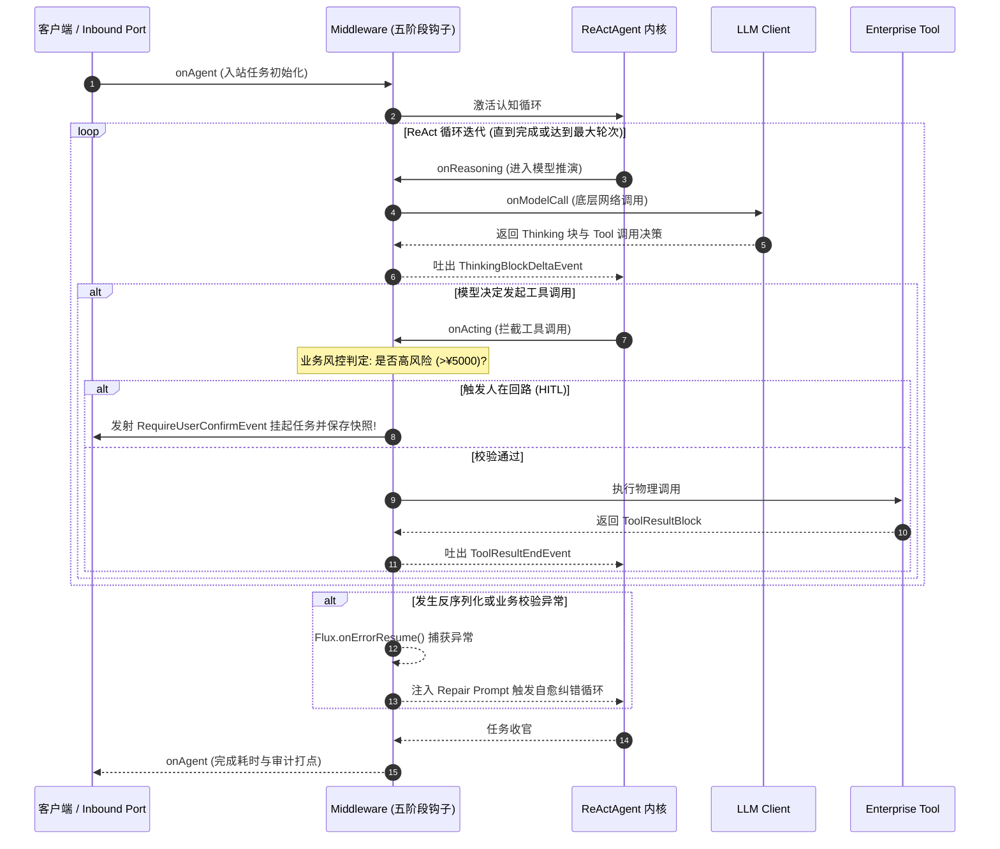

# 第九课《从手搓到框架：框架的边界》课后扩展学习指南

> **定位说明**：本指南面向完成第九课核心内容（对比原生手搓、Spring AI 2.0 现代基础设施与 AgentScope 2.0 智能体框架）的 Java 后端工程师与企业系统架构师。第九课明确了基础通信层（Spring AI 2.0）与智能体运行时框架（AgentScope 2.0）的能力边界与选型标准，并落地了六边形防套牢架构。本指南旨在帮助学员深入底层源码与工程规范，系统掌握 **Spring AI 2.0 Advisor 反应式内核与工具循环接管机制、AgentScope Java 2.0 Harness 与五阶段 Middleware 生命周期架构、有状态 Checkpointer 增量差分与 Time-Travel 因果树表结构设计，以及六边形架构防框架套牢与 ArchUnit 自动化守护法则**。

---

## 3W 精选导读法则概览

本指南严格遵循 **3W 精选导读法则** 组织各深水区主题：
- **Why（生产触发场景）**：直击企业网关层全局 PII 审计破坏流式上下文、复杂 ReAct 循环无法在工具执行前介入风控、容器重启导致长任务执行栈丢失、以及 AI 框架频繁断代重构套牢核心资产的血泪痛点。
- **Where（权威一手信源）**：精选 Spring AI 与 AgentScope 官方规范与 GitHub 源码核心路径、LangGraph Checkpointer 原理文档、Alistair Cockburn 六边形架构奠基论文与工业级技术白皮书。
- **What（高效阅读指引）**：直击 `AdvisorChain` 双向执行时序、五阶段生命周期钩子拦截拓扑、Checkpointer DAG 状态版本树与 ArchUnit 架构守卫测试，为架构师提炼最具生产指导意义的工程心法。

---

## 专题一：Spring AI 2.0 `CallAdvisor` / `StreamAdvisor` 与 `ToolCallingAdvisor` 源码级机制走读

### 1. Why 为什么值得深潜（生产触发场景）
在企业网关与基础设施层接入大模型时，团队面临三大核心挑战：
- **场景 1（切面代码侵入与破坏响应式流）**：为了实现全局 PII 脱敏（如手机号、身份证掩码）或实时 Token 计费，初级开发常在业务 Controller 或调用层显式编写拦截代码。但在 SSE 流式响应（`Flux<ChatResponse>`）场景下，一旦在流式操作符中发生阻塞调用或未正确传递 Reactor Context，会导致流通道死锁、首字延迟（TTFT）大幅恶化或上下文链路信息丢失。
- **场景 2（工具递归循环失控导致天价账单）**：大模型 Function Calling 在返回 `finish_reason=tool_calls` 后，系统需要接管参数解析、反射执行工具、将执行结果塞回消息历史并再次请求模型。如果框架底层的工具调用循环缺乏最大迭代保护（Max Iterations Guard）或异常自愈分支，极易陷入模型与工具调用的无限震荡死循环，单次请求吞噬数百万 Token。
- **核心诉求**：必须从源码级彻底搞懂 Spring AI 2.0 的 **双向切面拦截机制（`CallAdvisor` / `StreamAdvisor`）** 与 **官方内置工具循环执行器（`ToolCallingAdvisor`）** 的底层运转机理。

### 2. Where 权威一手资料（核心信源与链接）
- **Spring AI 官方文档 · Advisors 体系与 Tool Calling 机制**：
  - Spring AI 官方 Advisors 规范文档（涵盖 CallAdvisor, StreamAdvisor, Order 机制）：  
    [Spring AI Reference - ChatClient Advisors](https://docs.spring.io/spring-ai/reference/api/chatclient.html#_advisors)
  - Spring AI 统一工具调用（Tool Calling & Function Calling）架构说明：  
    [Spring AI Reference - Tool Calling API](https://docs.spring.io/spring-ai/reference/api/tools.html)
- **GitHub `spring-projects/spring-ai` 核心源码路径**：
  - Advisor 核心抽象与责任链：`org.springframework.ai.chat.client.advisor.api.*`（包含 `CallAdvisor`, `StreamAdvisor`, `CallAdvisorChain`, `StreamAdvisorChain`）
  - 工具调用自动接管切面：`org.springframework.ai.chat.client.advisor.ToolCallingAdvisor`
  - 核心仓库地址：[spring-projects/spring-ai (GitHub)](https://github.com/spring-projects/spring-ai)

### 3. What 高效阅读指引（核心看点与避坑）

#### ① `AdvisorChain` 优先级排序规则与双向执行时序
Spring AI 2.0.2 GA 正式废弃了早期孵化阶段的 `CallAroundAdvisor`，统一抽象为 `CallAdvisor`（面向同步调用）与 `StreamAdvisor`（面向流式响应）。两者均继承自 Spring Framework 的 `Ordered` 契约。
- **双向责任链执行模型**：
  ```
  ChatClientRequest (入站)
     │
     ▼  [Order 升序：HIGHEST_PRECEDENCE 优先执行前置处理]
  Advisor 1 (Order=100)  ──► 前置处理 (PII 脱敏、Prompt 注入检查)
     │
     ▼
  Advisor 2 (Order=200)  ──► 前置处理 (Token 预算配额扣减)
     │
     ▼
  ChatModel 底层执行 (HTTP/RPC 请求大模型)
     │
     ▲  [Order 降序：Order 越大优先执行后置处理]
  Advisor 2 (Order=200)  ◄── 后置处理 (实际 Token 消耗计量审计)
     │
     ▲
  Advisor 1 (Order=100)  ◄── 后置处理 (敏感词过滤、掩码打码)
     │
  ChatClientResponse (出站)
  ```
- **源码要点**：查阅 `CallAdvisorChain.java` 的 `nextCall()` 方法。它维护了一个游标索引，在递归推进时，前置逻辑按链表正向执行；在底层 `ChatModel.call()` 返回后，栈帧回溯，后置逻辑按相反顺序逆向弹出。这与 Spring MVC 的 Filter / Interceptor 机制高度一致，符合 Java 架构师的心智模型。

#### ② `CallAdvisor` vs `StreamAdvisor` 的响应式流操作符挂载机制
- `CallAdvisor` 处理的是同步阻塞的 `ChatClientRequest` $\to$ `ChatClientResponse`。
- `StreamAdvisor` 处理的是 `ChatClientRequest` $\to$ `Flux<ChatClientResponse>`。
- **精读源码重点**：查阅 `StreamAdvisor.adviseStream()`。在实现流式切面（如 `TelemetryStreamAdvisor` 监控 TTFT 首字耗时）时：
  ```java
  @Override
  public Flux<ChatClientResponse> adviseStream(ChatClientRequest request, StreamAdvisorChain chain) {
      long requestStart = System.currentTimeMillis();
      AtomicBoolean firstTokenRecorded = new AtomicBoolean(false);

      return chain.nextStream(request)
          .doOnNext(response -> {
              if (firstTokenRecorded.compareAndSet(false, true)) {
                  long ttft = System.currentTimeMillis() - requestStart;
                  // 记录首字延迟 (TTFT) 指标至 Micrometer/OTel
                  log.info("[Telemetry] TTFT (Time-To-First-Token): {} ms", ttft);
              }
          })
          .contextWrite(context -> context.put("TRACE_ID", request.context().getOrDefault("traceId", "UNKNOWN")));
  }
  ```
- **避坑红线**：严禁在 `StreamAdvisor` 的流式管道中调用任何阻塞方法（如 `Mono.block()` 或阻塞式 JDBC 查询）。任何阻塞都会导致 Netty EventLoop 线程挂起，直接拖垮整个高并发网关的流式吞吐。

#### ③ `ToolCallingAdvisor` 源码剖析：如何接管 `finish_reason=tool_calls` 递归循环
`ToolCallingAdvisor` 是 Spring AI 2.0 中最精妙的内置切面之一，它负责将传统需要开发者手写 100+ 行的 Function Calling 循环完全黑盒化。
- **内部核心状态转移时序**：
  1. 模型返回 `ChatClientResponse`，检查 `response.chatResponse().hasToolCalls()`（即 `finishReason == "tool_calls"`）；
  2. 若为 `false`，说明模型输出了最终文本或正常终止，直接放行返回；
  3. 若为 `true`，提取响应中的 `List<AssistantMessage.ToolCall>`；
  4. 遍历每个 ToolCall，通过内部 `ToolCallingManager` 找到注册的 `@Tool` 方法（如 `SpringAi2ToolAdapter` 声明的方法）；
  5. 将大模型生成的 JSON 参数字符串反序列化为方法入参对象，反射执行方法，获得返回值；
  6. 将工具返回值包装为 `ToolResponseMessage` 追加到会话上下文消息列表中；
  7. **递归发起下一轮模型调用**：重新构建 `ChatClientRequest` 并再次调用 `chain.nextCall(newRequest)`，直到大模型返回 `finish_reason="stop"` 或达到配置的 `maxIterations` 阈值。

---

## 专题二：AgentScope Java 2.0 `HarnessAgent`、五阶段 `Middleware` 与 `StateStore` 架构深潜

### 1. Why 为什么值得深潜（生产触发场景）
当企业级应用从“单次问答”迈向“长流程自主决策智能体”时，Spring AI 级别的请求拦截器暴露出本质短板：
- **痛点 1（无法感知智能体内部认知生命周期）**：Spring AI 的 Advisor 只能看到单次 HTTP 请求。它根本不知道当前智能体处于 ReAct 的哪一轮（Iteration），无法在大模型的“思考推演（Thinking/Reasoning）”阶段单独注入干预规则，更无法在“工具调用（Acting）”发生之前对高风险动作实施拦截并向前端抛出人在回路（HITL）审批挂起。
- **痛点 2（单通道文本流无法满足现代化前端交互）**：现代 Agent UI（类似 DeepSeek R1、ChatGPT 4o）需要将“思维链（Thought）”、“工具执行过程卡片（Tool）”、“最终业务回答（Answer）”以及“审批提示（Approval）”分通道独立渲染。单通道文本流迫使前端用脆弱的正则表达式解析混合字符串。
- **核心诉求**：深入理解阿里开源的 **AgentScope Java 2.0** 架构，掌握其从 Agent Framework 跃迁为 **Agent Harness** 的核心设计思想。

### 2. Where 权威一手资料（核心信源与链接）
- **AgentScope 官方项目站与 GitHub 仓库**：
  - AgentScope Java 官方核心仓库（基于 Java 17+ 响应式反应式架构）：  
    [AgentScope Java GitHub Repository](https://github.com/agentscope-ai/agentscope-java)
  - AgentScope 核心设计哲学与多智能体通信白皮书：  
    [AgentScope Documentation](https://doc.agentscope.io/)
- **工业界顶层架构解读**：
  - 阿里云开发者社区官方长文：*"从 Agent Framework 到 Agent Harness，开源 AgentScope 项目新定位"*（深度剖析为什么 AI 系统需要 Harness 宿主工程）：  
    [阿里云开发者社区 AgentScope 架构定位专栏](https://developer.aliyun.com/article/agentscope-harness)

### 3. What 高效阅读指引（核心看点与避坑）

#### ① `ReActAgent` 与 `HarnessAgent` 的职责边界
AgentScope Java 2.0 确立了清晰的二层抽象体系：
- **`ReActAgent`（算法循环内核）**：负责单智能体内部经典的“推演（Reasoning） $\to$ 行动（Acting） $\to$ 观察（Observing）”认知闭环。它聚焦于 Prompt 组装、大模型推理调度、工具参数映射与循环终止条件判断。
- **`HarnessAgent`（企业级安全与运行时宿主）**：借鉴工业测试与航空电子领域的“安全线束（Harness）”隐喻，为 `ReActAgent` 提供四位一体的外围支撑环境：
  1. **Workspace**：智能体执行时隔离的文件临时目录、上下文临时工作区与草稿板（Scratchpad）；
  2. **Memory**：具备滑动窗口截断、摘要生成与长周期持久化同步能力的会话记忆底座；
  3. **Sandbox**：代码执行沙箱（对接 Docker、E2B 或 Daytona），严密隔离高危指令；
  4. **StateStore**：支持原子事务的状态持久化引擎，解耦会话状态与底层存储。

#### ② 五阶段 `Middleware` 认知周期执行时序
AgentScope 2.0 的 `MiddlewareBase` 将切面钩子直接打入智能体的全局认知周期，其执行时序如下：



- **架构对比洞察**：
  - Spring AI 的 Advisor 无法在 `Tool` 执行前将任务“挂起等待人类审批”。
  - AgentScope 的 `onActing` 可以直接返回 `Flux.just(new RequireUserConfirmEvent(...))` 并中断当前的工具下发，将任务安全挂起在检查点，这是高阶应用框架相对于基础设施的降维打击！

#### ③ 类型化 `AgentEvent` 反应式流（30+ 种事件）与多通道解耦
AgentScope 2.0 原生通过 `streamEvents()` 暴露出强类型事件流，前端通过识别 `event.channel` 即可实现精细化渲染：

| 通道名称 (Channel) | 典型 Event 类 | 携带载荷 (Payload) | 前端 UI 对应呈现 |
|:---|:---|:---|:---|
| **`control`** | `AgentStartEvent`, `AgentCompletedEvent` | `sessionId`, `executionId`, 耗时 | 顶部全局状态条（“智能体已就绪 / 任务已完成”） |
| **`thought`** | `ThinkingBlockStartEvent`, `ThinkingBlockDeltaEvent` | 思维链实时流式增量文本 | 可折叠的“深度思考中...”卡片（支持实时展开查看推演逻辑） |
| **`tool`** | `ToolCallStartEvent`, `ToolResultBlockEvent` | `toolName`, `arguments`, `result` | 步骤指示器（“正在查询联想 Y9000P 库存...”，显示加载 Spinner 与结果卡片） |
| **`answer`** | `TextBlockStartEvent`, `TextBlockDeltaEvent` | 最终业务回答增量 Token | 正式对话气泡（逐字打字机平滑流式输出） |
| **`approval`** | `RequireUserConfirmEvent` | `checkpointId`, 待审批工具与金额 | 居中高亮审批弹窗（“检测到高额订单 ¥8999，请确认是否支付？”） |
| **`repair`** | `CustomEvent("SchemaRepairTriggered")` | 校验失败原因、修复提示词、重试轮次 | 调试面板 / 状态条轻量提示（“检测到入参不合法，正在触发第 1/3 次自主自愈...”） |

#### ④ `StateStore` 与企业三层记忆系统的边界区分
架构师切忌犯下“引入框架就扔掉自身系统设计”的错误。必须看清 `StateStore` 的真正边界：
- **框架能做的**：`AgentScopeStateStore` 能够优雅地将 Agent 运行时的对话历史（Session Messages）与临时状态 KV 序列化至 Redis 或 MySQL。
- **框架不能做的（企业必须自建）**：
  1. **用户画像系统（User Profile）**：框架不知道什么是“客户消费等级”、“历史退货率”、“品牌偏好”。必须由企业自建画像抽取器（如第七课手写组件）并在领域服务中加载；
  2. **知识向量库权限穿透（Enterprise ACL RAG）**：框架内置的 RAG 往往是单租户玩具。企业级多部门敏感文档检索必须依赖带有行级安全策略（Row-Level Security / Zanzibar ACL）的企业知识中台。

---

## 专题三：有状态 Agent 的 Checkpointer 持久化、增量状态差分与 Time-Travel（时光倒流）表结构设计

### 1. Why 为什么值得深潜（生产触发场景）
在真实企业生产中，无状态（Stateless）的 LLM 调用假设必然破产：
- **场景 1（Kubernetes 滚动发布与 Pod 漂移）**：一个采购 Agent 正在执行包含 10 个步骤的复杂审批采购任务。执行到第 6 步时，运维触发了 K8s 滚动升级，承载任务的 Pod 被强制 `SIGTERM` 销毁。如果状态仅保存在 JVM 内存中，该任务瞬间沦为僵尸任务，用户端永久无响应。
- **场景 2（异步人在回路跨天审批）**：大额订单需要主管在企业微信或钉钉中完成审批。主管可能在 3 小时甚至 2 天后才点击“同意”。系统不可能在内存中阻塞持有连接 2 天，必须将智能体完整的调用栈与局部变量安全“休眠冻结”，待审批完成后精准“复水苏醒（Rehydration）”。
- **场景 3（线上排障与时光倒流分叉）**：线上发生客诉，Agent 在第 5 步错误调用了退款接口。排障人员需要回到第 4 步的历史状态，修改某个参数后“分叉（Fork）”出一条新执行链进行回放排查。
- 掌握 **Checkpointer 模式与因果版本树表结构设计** 是衡量 Agent 架构师段位的重要分水岭。

### 2. Where 权威一手资料（核心信源与链接）
- **工业界事实标准：LangGraph Persistence & Checkpointer**：
  - LangGraph 官方 Checkpointer 架构规范（涵盖 Thread, Checkpoint, Parent Checkpoint, State Reducer）：  
    [LangGraph Persistence & Checkpointers Guide](https://langchain-ai.github.io/langgraph/concepts/persistence/)
  - LangGraph 官方 Time-Travel 时光倒流与 Forking 机制实现文档：  
    [LangGraph Time-Travel How-to Guides](https://langchain-ai.github.io/langgraph/how-tos/human_in_the_loop/time-travel/)
- **本课程落地工程一手设计**：
  - PostgreSQL 检查点快照表结构：`enterprise-ai-agent-springai2/docs/schema-checkpoint.sql`
  - 核心状态实体模型：`com.example.agent.domain.AgentCheckpoint.java`

### 3. What 高效阅读指引（核心看点与避坑）

#### ① 状态因果版本树 DAG 表结构设计剖析
查阅 `schema-checkpoint.sql`，表结构设计蕴含了工业级持久化执行的核心精髓：
```sql
CREATE TABLE IF NOT EXISTS agent_execution_checkpoint (
    execution_id VARCHAR(64) NOT NULL,          -- 任务全局唯一执行链路 ID (对应 LangGraph thread_id)
    checkpoint_id VARCHAR(64) NOT NULL,         -- 当前快照的唯一版本 ID (如 chk-step-3-xxxx)
    parent_checkpoint_id VARCHAR(64),          -- 父检查点版本 ID (构建因果 DAG 链条的关键指针)
    session_id VARCHAR(64),                    -- 业务会话 ID
    user_id VARCHAR(64),                       -- 触发用户 ID
    state VARCHAR(32) NOT NULL,                -- 状态机状态 (PLANNING/EXECUTING/CONFIRMING/COMPLETED)
    step_cursor INT DEFAULT 0,                 -- 当前推进的步骤游标序号
    snapshot_json JSONB NOT NULL,              -- 核心上下文快照 (CallStack, Scratchpad, Steps, ConfirmMeta)
    created_at TIMESTAMP WITH TIME ZONE DEFAULT CURRENT_TIMESTAMP,
    PRIMARY KEY (execution_id, checkpoint_id)
);
```

#### ② 因果版本树（Causal DAG）与时光倒流分支（Forking）原理

```
[chk-0: 根规划完成] (parent=null)
       │
       ▼
[chk-1: 查商品规格] (parent=chk-0)
       │
       ▼
[chk-2: 查质保政策] (parent=chk-1)
       │
       ├───────────────────────────────────────────────┐ [时光倒流 Forking 分支]
       ▼                                               ▼
[chk-3: 决定下单拯救者] (parent=chk-2)             [chk-3B: 用户改主意买MacBook] (parent=chk-2)
       │                                               │
       ▼                                               ▼
[chk-4: 触发 HITL 审批挂起] (parent=chk-3)         [chk-4B: 重新比价决策完成] (parent=chk-3B)
```

- **分支演进逻辑**：当调用 `/api/v6/workflow/fork` 时，系统并不覆盖或删除 `chk-3` 与 `chk-4`，而是以 `chk-2` 为 `parent_checkpoint_id`，赋予一个新的 `forked_execution_id`，创建一条全新的执行链。这种**只追加、不修改（Append-Only）**的不可变状态设计，天然具备完备的审计回溯与排障能力。

#### ③ Full Snapshot（全量快照）vs State Delta（增量差分）存储选型对比

| 存储机制 | 写入性能 | 恢复（复水）速度 | 存储空间占用 | 生产适用场景与落地选型 |
|:---|:---|:---|:---|:---|
| **Full Snapshot（全量快照）** | 较低（每步均需序列化整个上下文，随步数线性增加） | **极高（O(1) 读取）**：单次从 DB 读取一行 JSONB 即可完整恢复 JVM 执行栈 | 较高（多版本存在较多冗余数据） | **任务步数较短（$\le 10$ 步）**、或人在回路挂起等长停顿点（如本课工程的默认落地模式）。 |
| **State Delta（增量差分）** | **极高（O(1) 写入）**：每步仅写入当前步骤新增或修改的局部变量（Delta Patch） | 较低（恢复时需沿 `parent_checkpoint_id` 向上回溯至根节点依次回放合并） | **极低**：严格存储修改量，无冗余数据 | **超长周期工作流（数百步）**、高频写入场景。 |

- **工业级混合存储方案建议**：
  采用 **“Redis 热暂存（增量差分）+ PostgreSQL 冷归档（关键节点全量快照）”**。在单次 ReAct 循环中，每次 Tool 执行结果通过 Redis Hash 记录 Delta；一旦进入 `CONFIRMING`（等待人脑审批）或 `COMPLETED`（终态），将累积状态合并为 Full Snapshot 刷入 PostgreSQL JSONB。

#### ④ 避坑要点：Java 序列化围栏与不可序列化对象灾难
在工程实现中，初学者最常犯的错误是直接将包含 `HttpClient`, `Database Connection`, `Thread` 或 `ChatClient` 实例的复杂对象塞入 Checkpoint 的工作区（Scratchpad）。这会导致 Jackson 在序列化时抛出 `InvalidDefinitionException`，直接引爆运行栈。
- **铁律**：`AgentCheckpoint` 内的 `snapshot_json` 必须**严格只包含基本数据类型、纯数据 DTO（Java Records）、List 与 Map**。所有外围连接、基础设施 Client 必须由 Spring IoC 容器根据配置重新按需绑定，实现“状态与连接的物理解耦”。

---

## 专题四：Alistair Cockburn 六边形架构（Ports & Adapters）在 AI Agent 系统中的防套牢实践

### 1. Why 为什么值得深潜（生产触发场景）
AI 软件工程与传统业务开发最大的不同，在于**第三方 AI 框架的极高更迭淘汰率**：
- **现实残酷教训**：2023 年 Spring AI 1.0.0-M1 推出，到 2024 年底 1.0.0-M4，再到 2026 年底 2.0.2 GA，API 经历了多次断代重构（如 `CallAroundAdvisor` 全面废弃、`Prompt` 构造方式颠覆）。许多团队在代码中各处 `@Autowired ChatClient` 或硬编码特定 SDK 注解，结果框架一次大版本升级，上万行企业业务代码惨遭报废。
- **更严峻的诉求**：团队可能在网关层使用 Spring AI 2.0，但在多智能体复杂业务线希望切换为 AgentScope 或 Embabel。
- 如何在拥抱前沿框架高生产力的同时，**确保企业的核心业务规则、风控判定模型、选品打分算法资产实现 100% 框架无关与零侵入？** 答案就是经典软件工程的至高瑰宝——**六边形架构（Hexagonal Architecture）**。

### 2. Where 权威一手资料（核心信源与链接）
- **软件设计奠基性论著**：
  - Alistair Cockburn 原始论文：*"Hexagonal Architecture (Ports and Adapters)"*（2005 奠基文献）：  
    [Alistair Cockburn 官方原著专栏](https://alistair.cockburn.us/hexagonal-architecture/)
  - Martin Fowler 架构专栏：*"Organizing presentation and domain logic"*：  
    [Martin Fowler Architecture Guide](https://martinfowler.com/architecture/)
- **现代化架构守护工具**：
  - ArchUnit 官方文档（Java 领域自动化架构边界与分层红线静态检测测试框架）：  
    [ArchUnit Official Documentation](https://www.archunit.org/)

### 3. What 高效阅读指引（核心看点与避坑）

#### ① AI Agent 系统六边形架构分层规范全景图

```
┌─────────────────────────────────────────────────────────────────────────────┐
│                       外部世界 (Driving & Driven Actors)                     │
│  [REST Controller]   [SSE Client]   [MySQL]   [Redis]   [MCP Servers]      │
└───────────┬───────────────────────────────────────▲─────────────────────────┘
            │ 调用                                  │ 驱动
┌───────────▼───────────────────────────────────────┴─────────────────────────┐
│                    适配器层 (Adapters Layer) - 随时可替换                   │
│                                                                             │
│  【入站适配器 Inbound Adapters】        【出站适配器 Outbound Adapters】       │
│  - SpringAi2WorkflowAdapter (8083)    - RedisPostgresCheckpointAdapter      │
│  - AgentScopeWorkflowAdapter (8084)   - McpEnterpriseToolAdapter            │
│  - WorkflowV7Controller (REST/SSE)    - SpringAi2ToolAdapter                │
└───────────┬───────────────────────────────────────▲─────────────────────────┘
            │ 实现                                  │ 实现
┌───────────▼───────────────────────────────────────┴─────────────────────────┐
│                     端口层 (Ports Layer) - 抽象接口契约                     │
│                                                                             │
│  【入站端口 Inbound Ports】             【出站端口 Outbound Ports】            │
│  - ShoppingAgentPort                  - CheckpointStorePort                 │
│                                       - EnterpriseToolPort                  │
└───────────┬───────────────────────────────────────▲─────────────────────────┘
            │ 驱动调用                              │ 依赖
┌───────────▼───────────────────────────────────────┴─────────────────────────┐
│            纯净领域核心层 (Pure Domain Core) - 绝对零框架依赖               │
│                                                                             │
│  - ShoppingDomainService (大额风控判定 >¥5000、限购规则、多维度选品打分)       │
│  - AgentCheckpoint (因果状态快照模型)                                         │
│  - ShoppingIntent / ToolOrderRequest (强类型业务领域模型)                     │
│  - 严格限制: 0 Spring 注解、0 Spring AI 依赖、0 AgentScope 依赖!            │
└─────────────────────────────────────────────────────────────────────────────┘
```

#### ② 依赖倒置铁律与双向平替验证
在我们的两个对照工程中，请重点对比以下目录：
- `enterprise-ai-agent-springai2/src/main/java/com/example/agent/domain/`
- `enterprise-ai-agent-agentscope/src/main/java/com/example/agent/domain/`
- **惊人发现**：两个工程的 `domain/` 与 `port/` 目录源码**100% 逐字相同**！
  - 核心风控规则（`ShoppingDomainService.isHighRiskAction()` 针对大额超 ¥5000 的拦截）写在领域层；
  - 选品打分算法（`scoreAndRankCandidates()`）写在领域层；
  - 当从 Spring AI 2.0 升级为 AgentScope 2.0 时，**Domain 层代码修改量为 0 行，Port 层接口修改量为 0 行**！所有框架更迭全部被限制在 `adapter/` 包内部。

#### ③ 用 ArchUnit 自动化守护架构红线
不要指望通过团队口头约定来维持架构边界，必须通过自动化测试在 CI 流水线中强制守护。以下是建议引入的 ArchUnit 单元测试范式：

```java
@AnalyzeClasses(packages = "com.example.agent")
public class HexagonalArchitectureRulesTest {

    @ArchTest
    public static final ArchRule domain_layer_must_not_depend_on_frameworks =
        noClasses()
            .that().resideInAPackage("..domain..")
            .should().dependOnClassesThat().resideInAnyPackage(
                "org.springframework.ai..",
                "io.agentscope..",
                "org.springframework.web..",
                "org.springframework.data.."
            )
            .because("纯净领域核心严禁被任何具体 AI 框架或 Web 容器套牢！");

    @ArchTest
    public static final ArchRule ports_must_be_interfaces =
        classes()
            .that().resideInAPackage("..port..")
            .should().beInterfaces()
            .because("端口层必须全部由纯抽象接口构成，确保依赖倒置");
}
```

---

## 配套自测思考题（Self-Check）

在研读完以上专题后，请尝试独立回答以下 3 道架构师级自测题，检验对生产级框架选型与架构治理的掌握情况：

### 思考题 1：Reactive Context 穿透与 StreamAdvisor 流式拦截死锁陷阱
**场景**：某团队基于 Spring AI 2.0 开发实时客服 Agent。架构师在 `StreamAdvisor` 中定制了一个 Token 计费与审计切面，需要在流式输出每一个 Token 块（`ChatResponse`）时，读取当前请求绑定的租户租约信息，并将当前的 Token 消耗数累加写入远程 Redis。
开发人员在切面中直接编写了如下代码：
```java
@Override
public Flux<ChatClientResponse> adviseStream(ChatClientRequest request, StreamAdvisorChain chain) {
    String tenantId = (String) SecurityContextHolder.getContext().getAuthentication().getPrincipal();
    return chain.nextStream(request)
        .map(response -> {
            redisTemplate.opsForValue().increment("tenant:tokens:" + tenantId, 1);
            return response;
        });
}
```
上线压测后，系统立即出现两个严重故障：① `tenantId` 偶发变为 `null` 并抛出 NPE；② 整体流式输出吞吐量骤降 90%，客户端收到流式数据的延迟极大。
请从 **Reactor 响应式线程模型、ThreadLocal 传递与 I/O 阻塞机制** 角度，深入剖析原因，并给出正确的重构架构方案。

> **参考架构思路**：
> 1. **故障原因深度剖析**：
>    - **ThreadLocal 丢失问题**：`SecurityContextHolder` 默认基于 `ThreadLocal` 存储。在 Project Reactor 响应式流管道中，`Flux` 的操作符往往被调度在不同的 Netty I/O 线程或弹性调度器线程（Schedulers）上执行。当流式操作发生线程切换时，`ThreadLocal` 中的上下文信息无法自动跨线程传播，导致下游 `tenantId` 变为 `null`。
>    - **EventLoop 线程阻塞问题**：`redisTemplate.opsForValue().increment()` 是同步阻塞式 I/O 调用。在 `map()` 操作符中对每一个 Token 块同步调用 Redis，会直接阻塞执行该流的底层 Netty EventLoop 工作线程。由于 EventLoop 线程总数通常等于 CPU 核心数，少量并发流就会耗尽全部 EventLoop，导致整个服务响应式网络通道全部瘫痪，吞吐量断崖式暴跌。
> 2. **正确重构架构方案**：
>    - **上下文传播重构**：使用 Reactor 的不可变上下文 `contextWrite()` 与 `deferContextual()`，或使用 Spring Framework 7 / Micrometer 的 `ContextRegistry` 机制，在进入响应式流前将租户标识写入 Reactor Context，确保跨操作符透明传播。
>    - **流式非阻塞与批量合并**：严禁在 `map()` 逐字打点中同步调用外部存储！改用异步响应式客户端（如 `ReactiveRedisTemplate`）配合操作符窗口合并（如 `.window(Duration.ofSeconds(1))` 或 `.buffer(50)`），将单次交互生成的 Token 数在客户端流结束（`doOnComplete`）时异步合并批量刷入 Redis，保护高并发通道。

---

### 思考题 2：Time-Travel 分支回滚中的外部物理副作用与 Saga 补偿联动
**场景**：在包含 7 个步骤的企业差旅审批与采购 Agent 中：
- 第 1 步：检索员工差旅标准与预算合规性；
- 第 2 步：调用外部航司 API 锁定了机票并生成了预定号（产生了外部系统物理副作用）；
- 第 3 步：进入人在回路（HITL），等待部门主管审批；
- 主管在审批时，认为该航班时间不合理，要求：“*不要订这张票，改查明天早上的高铁*”。
运维架构师尝试调用 `/api/v7/workflow/fork` 接口，从第 1 步的 Checkpoint 分叉生成一条新的执行链路，让 Agent 重新推演高铁路线。
如果系统仅仅在数据库层面分叉了 Checkpoint 记录，会带来什么严重的业务灾难？在架构设计上，**Time-Travel 时光倒流机制必须与分布式 Saga 事务模式怎样联动**？

> **参考架构思路**：
> 1. **严重的业务灾难**：
>    - 产生**外部资源悬空泄漏与资产损失**。虽然 Checkpoint 在数据库中回滚分叉到了 Step 1，使得 Agent 的本地推演栈重置了，但航司外部系统中预定的机票**并没有被取消**！航司会继续保留锁票甚至触发自动扣款，导致企业差旅账户资金被扣除，产生幽灵订单。
> 2. **与 Saga 补偿机制的联动架构规范**：
>    - **快照必须记录副作用补偿元数据（Compensating Actions）**：在 Checkpoint 的 `snapshot_json` 中，不能只记录 Scratchpad 数据，必须同时持久化当前状态树已产生外部副作用的逆向补偿动作清单（如 `{"action": "cancelFlightReservation", "reservationId": "FLY-8801"}`）。
>    - **Forking 时的分支差分审计（Branch Diffing）**：当系统从历史节点 `chk-1` 分叉新链路时，状态机必须对比当前被废弃分支（`chk-2` $\to$ `chk-3`）与基准分叉点之间的差异，自动检测到 `chk-2` 产生过不可忽略的外部物理副作用。
>    - **自动触发逆向 Saga 回滚**：在激活新分支之前，系统必须先按 LIFO 逆序调用外部系统的取消补偿接口，确保航司资源成功释放，再正式启动高铁分支的推演，保证数字执行栈与物理外部世界的严格一致性。

---

### 思考题 3：多智能体分布式通信下的六边形 Outbound Port 边界设计
**场景**：某团队计划在第 10 课将系统演进为 Multi-Agent（多智能体协作网络），包含“导购 Agent”、“仓储物流 Agent”与“财务支付 Agent”。
团队中有两种架构派系：
- **派系 A**：认为每个 Agent 内部直接注入对方的 Service 或调用特定框架的 `Subagent` 抽象（如在 Spring AI 中直接注入另一个包含 `ChatClient` 的组件，或直接依赖特定开源框架的 Agent 通信机制）；
- **派系 B**：坚持六边形架构，认为所有 Agent 之间的协作通信必须抽象为出站端口（Outbound Port），下层适配器基于标准协议（如 Google A2A 协议、JSON-RPC 或 CloudEvents）实现。
请评估两种派系对系统长期可维护性、测试隔离度与团队组织架构协同（Conway's Law 康威定律）的影响，并给出六边形端口契约的设计方案。

> **参考架构思路**：
> 1. **架构影响评估对比**：
>    - **派系 A（紧耦合黑盒）**：初期开发极快，但违反了单一职责原则。各个 Agent 的内存、上下文和异常处理深度纠缠在一起。一旦某个 Agent 底层升级框架（如一个用 Spring AI，另一个用 AgentScope），代码彻底无法互通；单测无法独立 Mock，线上排障时链路追踪混乱不堪；随着团队规模扩大，严重违反康威定律，不同小组成员互相踩踏代码。
>    - **派系 B（六边形松耦合）**：契约明确，边界森严。每个 Agent 是一个自治的微核心。
> 2. **推荐的六边形 Outbound Port 契约设计方案**：
>    - **抽象通用协作端口**：
>      ```java
>      public interface AgentCollaborationPort {
>          Mono<AgentMessageEnvelope> dispatchToAgent(
>              String targetAgentId, 
>              AgentMessageEnvelope envelope
>          );
>      }
>      ```
>    - **信封协议标准化**：载荷严格采用标准化的消息信封（Envelope），包含 `traceId`, `sourceAgentId`, `targetAgentId`, `capability`, `payloadJson`。
>    - **适配器灵活插拔**：
>      - 本地单体测试时：注入 `LocalInProcessAgentAdapter`，走 JVM 内部内存事件总线，单测秒级完成；
>      - 生产分布式部署时：无缝切换为 `HttpA2aProtocolAdapter`（遵循 Google A2A 标准）或 `KafkaEventBusAdapter`，实现真正跨微服务、跨编程语言的企业级 Multi-Agent 协同集群。
