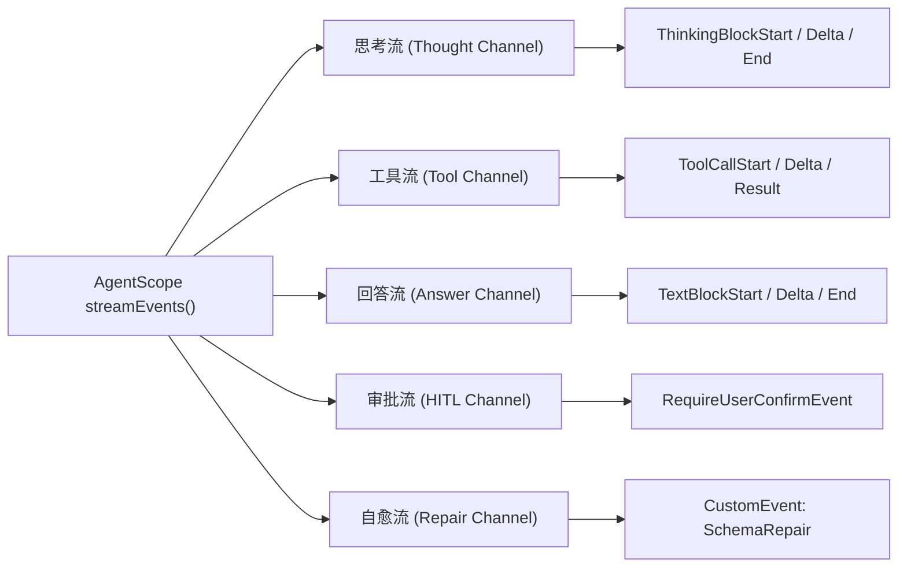

# AgentScope 2.0 深度架构决策记录 (v7.0-agentscope-decisions)

> **课程归属**：第 09 课《从手搓到框架：框架的边界》（24P 黄金容量）  
> **核心命题**：两级阶梯跃迁（Spring AI 1.0 手搓 $\to$ Spring AI 2.0 基础设施 $\to$ AgentScope 2.0 应用框架）的生产力质变与架构防套牢

---

## 1. 技术演进两级阶梯：从基础设施到应用框架

在 AI Agent 架构演进史上，Java 开发者常将“底层基础设施”与“上层应用框架”混为一谈。课程通过三套工程同屏对照，确立了清晰的阶梯分层：

```
┌─────────────────────────────────────────────────────────────────────────────┐
│                       全课程三套工程同屏对照架构体系                               │
└─────────────────────────────────────────────────────────────────────────────┘
  第 0 级：enterprise-ai-agent 【手搓原版】(v5.0-workflow)
     ├── 技术栈: Spring AI 1.0.0-M4 + Spring Boot 3.4.1 + Java 17
     ├── 状态: 永久冻结于 commit 0839d6b
     └── 定位: 扒开齿轮看机理（手写 1761 行状态机、ReAct 循环、三层记忆与 MCP 治理）

  第 1 级阶梯跃迁：enterprise-ai-agent-springai2 【现代基础设施版】(v6.0-springai2)
     ├── 技术栈: Spring AI 2.0.2 GA + Spring Boot 4.0.0 + Java 21
     └── 定位: 底层基础设施 API 现代化（ChatClient.builder()、@Tool、Advisors、内置 MCP）
              【看清：API 变优雅了，但多轮状态机、任务规划与 Checkpoint 仍需手搓】

  第 2 级阶梯跃迁：enterprise-ai-agent-agentscope 【高阶应用框架版】(v7.0-agentscope)
     ├── 技术栈: io.agentscope:agentscope:2.0.0 + Spring Boot 3.4.1 + Java 17+
     └── 定位: 企业级应用框架与生产力底座（ReActAgent、Middleware 钩子、28类事件流、Checkpointer）
              【看清：框架如何彻底消灭胶水层，提升研发吞吐量与系统韧性】
```

---

## 2. 八大手搓组件全景映射与代码行数对比表

以下汇总了从手搓原版（v5.0）、Spring AI 2.0 基础设施升级版（v6.0）到 AgentScope 2.0 高阶应用框架重构版（v7.0）的代码映射与量化对比：

| # | 核心职责 | 手搓原版 (`enterprise-ai-agent` v5.0) | Spring AI 2.0 (`springai2` v6.0) | AgentScope 2.0 (`agentscope` v7.0) | 架构质变洞察 |
|:---:|:---|:---|:---|:---|:---|
| **1** | **状态机核心循环** | `AgentRuntime.java` (**651 行**)<br>手写 while 循环与 THINK/ACT/OBSERVE | `SpringAi2WorkflowAdapter.java` (**约 280 行**)<br>ChatClient + 手写多轮循环 | `AgentScopeWorkflowAdapter.java` (**约 110 行**核心编排)<br>官方 `ReActAgent` 内置接管 | **消灭 83% 状态机胶水代码**，多轮收敛与异常回退由框架完全接管 |
| **2** | **任务规划分解** | `TaskPlanner.java` (**174 行**)<br>Prompt 约定 JSON + 正则脆弱解析降级 | `PlannerService.java` (**约 90 行**)<br>结构化输出 Bean 反序列化 | `ReActAgent` 原生思维链推演<br>无需独立规划器，推演内化于循环 | **告别脆弱正则解析**，模型具备自主动态规划与修正能力 |
| **3** | **状态机与游标** | `WorkflowState.java` + `WorkflowStep.java` (**126 行**)<br>硬编码 7 状态枚举 | 自定义状态模型 (**约 80 行**) | `AgentState.java` + `AgentCheckpoint.java`<br>三级边界解耦（Chat / State / Checkpoint） | 统一 Checkpointer 模式，支持跨进程状态序列化与复水 |
| **4** | **人在回路 (HITL)** | `ConfirmationService.java` (**147 行**)<br>字符串 contains 简单匹配高风险 | `RiskCheckAdvisor.java` (**约 110 行**)<br>Advisor 链拦截 | `LifecycleMiddleware.java` (**190 行**)<br>五阶段钩子 + `RequireUserConfirmEvent` | 深度感知智能体生命周期，精确在 `onActing` 工具调用前挂起并持久化快照 |
| **5** | **容错与模式自愈** | `ErrorRecovery.java` (**138 行**)<br>手写指数退避、计数器熔断与降级 | Resilience4j + 重试 Advisor (**约 100 行**) | `SchemaRepairMiddleware.java` (**114 行**)<br>Bean Validation 拦截 + Repair Prompt 自愈 | **从粗暴熔断降级升级为认知自愈**，模型根据校验详情自动纠偏 |
| **6** | **可观测与追踪** | `TraceService.java` (**218 行**)<br>内存 ConcurrentHashMap 易 OOM | Spring AI OpenTelemetry 适配器 (**约 120 行**) | 28 类类型化 `AgentEvent` + `AgentScopeCheckpointStore` | 单机内存 Trace 升级为类型化事件流与可回溯 DAG 版本血缘树 |
| **7** | **工具接入与协议** | `McpProductClient.java` (**201 行**)<br>手动 SSE 传输、握手与 Callback 包装 | Spring AI 2.0 内置 MCP Client (**约 80 行**) | `ShoppingAgentTools.java` (**121 行**)<br>`@Tool` + `@ToolParam` + Jakarta 校验 | 告别繁琐协议握手代码，纯声明式注解注册工具，入参强契约约束 |
| **8** | **对外端点与流式** | `WorkflowController.java` (**380 行**)<br>同步阻塞 + 延迟发射拆字符串伪流式 | `Flux<ChatResponse>` 单文本流 (**约 150 行**) | `WorkflowV7Controller.java` + `AgentEventStreamBridge` (**186+177 行**) | 彻底告别伪流式，输出思考/工具/回答/审批多通道解耦 SSE 流 |
| **合计** | **核心编排总行数** | **1834 行**（手搓胶水沉重） | **约 950 行**（API 优雅但仍需手搓编排） | **约 500 行**（高度聚焦领域风控与业务语义） | **代码质量与维护性发生代际跃迁** |

---

## 3. Spring AI Advisor vs AgentScope Middleware 架构哲学对比

第 09 课 P11~P14 重点解构了两种扩展机制的本质差异：

```
┌─────────────────────────────────────────────────────────────────────────────┐
│         Spring AI 2.0 Advisors 机制：面向单次请求/响应的责任链过滤器         │
└─────────────────────────────────────────────────────────────────────────────┘
  Request ──► [Advisor 1: PII Mask] ──► [Advisor 2: Token Count] ──► LLM Call
  Response ◄─ [Advisor 1: PostProc] ◄─ [Advisor 2: Token Log]   ◄── LLM Result
  【痛点】：Advisor 只能看到单次 HTTP/RPC 调用，根本不知道当前处于 ReAct 的哪一轮，
           更无法在中间某一步工具调用前把智能体挂起等待人脑审批！

┌─────────────────────────────────────────────────────────────────────────────┐
│       AgentScope 2.0 Middleware 机制：贯穿智能体全局认知周期的五阶段钩子     │
└─────────────────────────────────────────────────────────────────────────────┘
  [Phase 1: onAgent]       智能体任务入站与退出生命周期拦截
       │
  [Phase 2: onReasoning]   大模型思考推演拦截（Thought Chain 监控、Token 预算控制）
       │
  [Phase 3: onActing]      工具调用拦截（参数 Bean Validation、风控判定、HITL 挂起）
       │
  [Phase 4: onModelCall]   底层模型客户端网络传输与重试
       │
  [Phase 5: onError]       全局异常捕获，触发 Schema Repair 自愈修复提示词
```

### 关键架构结论：
- **Spring AI Advisor** 继承了 Servlet Filter / Spring MVC HandlerInterceptor 的经典请求/响应模型，适合做通用的模型层切面（如全局日志、Token 计量、前置 PII 脱敏）。
- **AgentScope Middleware** 是真正的**智能体认知过程拦截器**。它将钩子嵌入到智能体认知决策的各个核心关节（`onReasoning`, `onActing`），因此能够在工具执行前捕获业务高风险、保存 Checkpoint 快照、并抛出 `RequireUserConfirmEvent` 优雅挂起任务。

---

## 4. 单通道文本流 vs 28 类类型化 AgentEvent 多通道流对比

在第 08 课手搓工程中，`WorkflowController.executeStream()` 存在一个极为尴尬的妥协：  
由于底层 ReAct 循环是同步阻塞执行的，为了在前端展示打字机效果，后端只能在全部执行完毕后，将最终回答字符串拆成字符数组，用 `Flux.interval(15ms)` 人为延迟发射——**这是典型的伪流式（Fake Streaming）**！

而在 Spring AI 2.0 中，虽然底层支持了 `Flux<ChatResponse>`，但流中吐出的是单一维度的文本 Token，大模型的思考推演、工具入参片段与最终回答混杂在一起，前端无法结构化解析。

### AgentScope 2.0 的 28 类类型化事件流杀手锏
AgentScope 2.0 GA 原生提供了 `streamEvents()` 反应式流，独立于拦截机制，涵盖 28 种强类型事件：



**多通道解耦的商业与工程价值**：
1. **思考过程与结果展示物理分离**：前端可将 `ThinkingBlockDeltaEvent` 渲染至专用的可折叠“深度思考中...”卡片（类似 DeepSeek R1 体验），而将 `TextBlockDeltaEvent` 渲染在正式回答气泡中，彻底消除格式混淆。
2. **工具调用实时可观测**：前端实时收到 `ToolCallStartEvent("query_product")`，即刻点亮 UI 步骤节点为“正在查询商城库存...”，用户感知延迟由 3~5 秒骤降为 0 毫秒。
3. **人在回路无缝穿透**：当中间件发射 `RequireUserConfirmEvent` 时，前端直接激活交互弹窗（“是否同意支付 ¥8999 购买拯救者？”），用户点击后调用 `/confirm` 端点恢复执行。

---

## 5. HarnessAgent 能力映射与企业三层记忆边界辨析

在第 09 课 P19 中，必须重点辨析 **AgentScope Harness 体系与企业自建系统的实现边界**，防止学员误以为“有了框架就万事大吉”：

### 5.1 HarnessAgent 四大支柱映射
- **Workspace**：提供智能体执行时隔离的文件目录与上下文工作区。
- **Memory**：封装会话历史短期上下文，提供滑动窗口与摘要压缩。
- **Sandbox**：对接 Daytona / E2B / Kubernetes，隔离执行生成的 Python/Shell 代码。
- **StateStore**：支持持久化 Agent 运行状态（`InMemory`, `Redis`, `MySQL`, `Postgres`）。

### 5.2 核心边界辨析：State Store 状态持久化 != 完整企业三层记忆系统

| 记忆分层 | 手搓原版 (`enterprise-ai-agent`) | AgentScope 2.0 框架能力 | 架构边界与职责划分 |
|:---|:---|:---|:---|
| **第一层：会话缓冲**<br>(Session Memory) | 手搓 Redis 存储 `sessionId` 下的多轮 List，手写滑动窗口截断 | `StateBackedMemory` + `RedisAgentStateStore` 接管会话消息 | **框架完全覆盖**：框架可原生管理会话消息出入栈与状态保存。 |
| **第二层：用户画像**<br>(User Profile) | 手写 `UserProfileExtractor` 从对话中异步抽取消费力、偏好并存入 MySQL | 框架仅提供 KV 扩展槽位，无业务画像抽取与分析能力 | **必须由开发者自建**：框架不知道什么是“预算上限”、“偏好品牌”，画像提取逻辑属于核心领域资产。 |
| **第三层：历史检索**<br>(Long-Term RAG) | 手写 `pgvector` 向量表、分块切片与余弦相似度检索 | 框架提供 RAG 扩展（`RagStore` / Bailian / Dify），但无企业 ACL 穿透 | **必须深度定制**：企业历史订单关联、权限穿透检索必须由企业知识中台提供。 |

> **架构师警言**：框架接管的是通用基础设施（状态存取），而业务记忆（用户是谁、喜欢什么、买过什么）永远需要开发者深耕业务领域。

---

## 6. 六边形防套牢架构：如何实现 Spring AI 2.0 与 AgentScope 的零修改平替

在传统的紧耦合开发中，业务 Controller 往往直接使用框架特定注解（如 `@Autowired ChatClient` 或 `@Autowired ReActAgent`），一旦需要切换框架，几乎要重写全部业务层。

本工程通过六边形架构彻底解决了这一痛点：

```java
// 业务控制器仅依赖入站端口 ShoppingAgentPort，对底层具体框架毫不知情
@RestController
@RequestMapping("/api/workflow")
public class WorkflowController {
    
    // 注入端口接口，底层实现可以在 SpringAi2WorkflowAdapter 与 AgentScopeWorkflowAdapter 之间随时切换！
    private final ShoppingAgentPort shoppingAgentPort;
    
    public WorkflowController(ShoppingAgentPort shoppingAgentPort) {
        this.shoppingAgentPort = shoppingAgentPort;
    }
    
    @PostMapping("/execute")
    public Result execute(@RequestParam String message) {
        return shoppingAgentPort.executeTask(null, "s1", "u1", message);
    }
}
```

### 平替证明结论：
- **`com.example.agent.domain` 核心包**：包含 `ShoppingIntent`, `AgentCheckpoint`, `ToolOrderRequest`, `ShoppingDomainService` 等 4 个核心类，**0 框架注解，0 第三方 AI 依赖**。
- **`com.example.agent.port` 端口包**：包含 `ShoppingAgentPort`, `CheckpointStorePort`, `EnterpriseToolPort`，纯接口定义。
- 当我们将底层从 `enterprise-ai-agent-springai2` 切换为 `enterprise-ai-agent-agentscope` 时：
  - **Domain 核心代码修改量：0 行！**
  - **Port 端口契约修改量：0 行！**
  - **所有框架更迭均被牢牢锁在 `adapter.agentscope` 适配器内部！**

这正是六边形架构赋予企业级 AI 智能体应用的最强大武器——**拥抱框架的生产力，守住业务的自主权，彻底告别框架套牢！**
